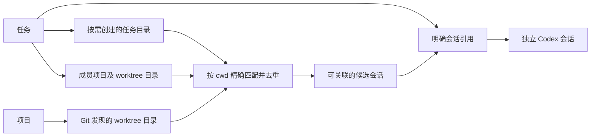

# 任务、项目与会话解耦

任务负责组织目标、项目工作目录和明确关联的会话；项目管理仓库和 worktree，会话独立存在。任务中的「相关会话」默认只展示显式引用。按目录查询用于发现可能相关的会话，项目页继续按目录聚合。引用不代表会话所有权。

## 关系与查询



- 任务目录集合包含成员的实际 `path`，以及已实际创建的任务工作区。`has_workspace=false` 表示只预留路径，不创建目录；只有新增 Worktree 时才按需创建。旧记录保留其工作区位置。
- 同一 worktree 可以被多个任务复用；目录发现结果可以相同，默认展示的显式会话引用分别保存。
- 项目的目录集合来自 Git worktree 清单，包括登记目录和 detached worktree；不额外维护一份 worktree 数据库。
- 目录匹配使用平台路径规范化与相等比较，不按前缀匹配。会话在子目录启动时，不会自动算作父目录的会话。
- 会话的 cwd 表示主工作目录，不表示它曾访问过的全部项目。
- 更改任务成员目录会改变聚合列表，不删除会话或 Codex 历史。
- 手动关联和从任务新建的会话保存到 `task_session_pins`。解除项目关联、更换目录和归档任务均保留这些引用；取消会话引用不删除会话或停止运行。

## 数据模型

每个运行环境已经使用独立的数据库及 Codex 连接。跨环境的会话标识为 `environment_id + session_id`；单个数据库内以会话 ID 为主键，不重复存储环境 ID。

| 表 | 职责 |
| --- | --- |
| `projects` | 保留仓库登记信息、登记路径和 Git common directory |
| `requirements` | 保留任务信息、自身目录和状态 |
| `members` | 保存任务关联的项目、具体目录、分支等工作现场配置 |
| `sessions` | 独立会话索引，没有任务或项目外键 |
| `task_session_pins` | 保存手动关联及从任务创建的会话引用 |
| `conversation_create_requests` | 环境内的创建请求标识、请求摘要和结果会话 ID |
| `schema_migrations` | 记录已完成的迁移，避免重启后反复恢复旧关联数据 |

`sessions` 保存 `id`、`name`、`cwd`、`created_at`、`updated_at`、`source`、`last_synced_at` 和 `additional_directories`。最后一项是创建或显式终端启动时选定的额外目录快照；切换任务入口不会重新计算它。运行状态、审批和消息正文不写入该索引，完整历史由 Codex 提供。

`source` 仅表示来源，不表示所有权。手动引用的展示状态由 `task_session_pins` 决定。

标题的 `title_source` 与 `title_changed_at` 单独记录命名来源和更新时间。空名称只在界面显示占位，新建时提取短标题并写入 Codex；首条输入被接受后，通过独立连接的临时对话额外调用一次模型，仅根据首次输入生成主题标题，与正文并行，后台核对并写回，手动名称优先保留。之后不随消息反复改名。详见[标题规则与旧数据修复方案](session-title-repair.md)。

消息中的文件链接由 Markdown 自定义链接组件拦截，通过 `GET /api/sessions/{session}/file` 在当前执行环境读取，不导航到静态资源路由。后端以会话已保存的 cwd 和附加目录为边界，解析真实路径并拒绝越界符号链接、目录、二进制及超过 512 KiB 的文件；按引用行返回最多 401 行纯文本。前端在所属会话面板内挂载只读预览，显示行号并高亮引用行；网页链接通过受限的 `POST /api/sessions/{session}/open-link` 调用系统浏览器。

## 服务和接口

查询范围在入口层解析为目录集合，执行入口解析为主目录、额外目录及可选说明。会话运行层只处理环境内的会话 ID 和执行配置，不读取任务状态，也不按任务创建运行实例。

| 接口 | 行为 |
| --- | --- |
| `GET /api/sessions` | 查询当前环境的会话 |
| `GET /api/sessions?task_id=...` | 按任务目录集合及引用发现会话，供选择关联使用 |
| `GET /api/sessions?task_id=...&linked=true` | 仅查询明确关联的会话；支持按当前目录及引用会话的实际 cwd 筛选 |
| `POST /api/requirements/{id}/sessions` | 引用已有会话，保留原执行配置 |
| `DELETE /api/requirements/{id}/sessions/{session}` | 取消引用，会话和运行保留 |
| `GET /api/sessions?project_id=...` | 按项目所有 worktree 查询 |
| `GET /api/sessions?cwd=...` | 查询一个具体目录，可与任务或项目范围组合缩小查询 |
| `POST /api/sessions/new` | 在已验证的项目 worktree 或任务目录创建会话 |
| `/api/sessions/{session}/history` | 分页读取历史 |
| `/api/sessions/{session}/history/events` | 订阅终端历史更新 |
| `/api/sessions/{session}/chat` | 读取运行状态或发送消息 |
| `/api/sessions/{session}/chat/events` | 订阅当前轮次 |
| `/api/sessions/{session}/chat/stop` | 停止当前轮次 |
| `/api/sessions/{session}/chat/approval` | 回答审批或问题 |
| `/api/sessions/{session}/chat/approval/open` | 打开审批要求的外部页面 |
| `/api/sessions/{session}/chat/handoff` | 从受管理的终端交接到界面对话 |
| `/api/sessions/{session}/resume` | 在终端继续会话 |

接口沿用当前的本地认证、CSRF 校验和 `X-Environment-ID` 环境路由。

项目目录创建示例：

```json
{"project_id":"project-id","cwd":"/repos/apix-worktree","text":"检查实现","request_id":"unique-request-id"}
```

任务创建可传 `task_id`，再通过 `project_id` 选择成员目录，或通过 `cwd` 明确选择任务自身目录。主目录和额外目录在服务端校验后保存。新建时可传 `additional_directories` 明确选择任务内其他可用项目目录，空数组表示不附加。任务根目录不隐式作为附加权限根；一个成员失败不会阻止使用其他可用成员。继续已有会话使用 Codex 返回的实际 cwd，并保留既有执行配置、模型和审批策略；不因为当前打开的任务改变访问目录。

旧 `/api/requirements/{id}/sessions/...` 接口暂时保留。其适配层验证原有任务范围和启动条件，再调用同一套会话操作。新前端使用通用接口；原任务归档不会阻止从全局接口继续会话。

运行实例以环境内会话 ID 为键。不同入口共享实时消息、审批、停止操作和运行状态；目录占用也按环境及实际 cwd 检查。创建请求在调用 Codex 前持久化：重复请求复用结果，参数改变时拒绝复用标识，结果不明确时阻止隐式重复创建。

WSL 辅助程序将历史实时订阅与普通请求放在两个独立的并发池中，各最多 8 个；长期订阅不会挤占 Git、文件读取和会话占用检查的名额。并发池满时返回 `busy` 错误码。页面会话运行中的占用检查遇到辅助程序繁忙或检查超时，会在下一次定时检查重试，不中断当前轮次；开始发送前仍必须通过检查，检测到实际终端占用时仍请求停止。

## 迁移与验证

启动迁移在事务中从旧 `requirement_sessions` 汇总会话索引：同一会话去重并保留最新元数据，只有 `manual` 记录转换为额外引用。旧创建请求迁入独立请求表，包括尚未确认的请求。旧表暂时保留；自动发现不再写入旧任务关联表。元数据导出和导入同时兼容旧表与新索引。

新增测试覆盖共享 worktree、任务自身目录、无任务的 detached worktree 创建、任务归档后的独立运行、跨任务读取及控制同一运行、目录范围变化、创建幂等、上下文保持、索引迁移及跨环境隔离。

## 会话独立页与浮层

任务页保留一个「相关会话」入口，所选项目保留一个「项目对话」入口；worktree 和任务目录行不重复放按钮。前者默认展示明确关联的会话，浮层可关联已有记录或新建；后者默认聚合全部项目 worktree。全局导航「会话」默认汇总所有已登记环境的对话，每条显示本机、WSL 等环境标签；环境仅作为可选筛选条件，选择和打开会话不切换项目执行环境。固定任务与目录入口也跨环境展示，固定配置继续按所属环境保存。

`frontend/workspace/session-browser.tsx` 定义共享浏览器结构与列表渲染；`web/features/sessions/session-workspace.js` 管理范围、目录筛选、选择与宿主切换。同一浏览器 DOM 在页面宿主和原生 `<dialog>` 之间移动，浮层转独立页不会重新挂载聊天。列表单独刷新，任务与 Git 轮询不会重建输入框。

目录筛选通过通用接口的 `task_id` / `project_id` 与 `cwd` 组合查询，响应按请求代次和执行环境校验，过期结果不覆盖新范围。任务、项目和具体目录均为视图范围，不写回会话所有权。任务查询额外使用 `linked=true` 限定显式引用，关联选择器优先提供目录发现结果。全局范围选择支持跨环境搜索任务、项目和目录。浏览器并行请求各环境并逐步合并结果，某个环境失败时保留其余环境的结果并标明失败来源；切换筛选后旧响应不能覆盖新范围。列表选择、目录筛选、未读标记及会话缓存使用环境与会话 ID（或路径）的组合标识。详情、实时流、创建及关联操作显式传入记录所属环境，不依赖项目页当前选择。

聚合范围新建必须先选择具体目录；筛选单个目录后新建固定使用该目录。任务自身目录也在选项中；未关联任务的 detached worktree 可以从项目范围新建。只读模式保留历史和终端继续入口，禁用界面新建。

已有会话按 `environment_id + session_id` 复用控制器，共享草稿、附件、阅读位置和运行状态。尚未发送的草稿按创建目标隔离。浮层转独立页携带范围、目录筛选与当前会话；关闭浮层返回原工作区，保留任务滚动与展开状态。关闭或切换页面只取消界面订阅，不调用停止接口。

后台刷新已知会话活动；导航分别提示「运行中」「待确认」「有新消息」。窄窗口在列表和详情之间切换，列表视图不把隐藏的详情算作已读。测试覆盖目录精确匹配、任务与项目的不同聚合、任务自身目录与 detached worktree 创建、响应乱序、跨环境隔离、共享宿主转移及关闭后运行继续。

## 对话交互与恢复

运行中的对话保留输入框，发送会调用当前轮次的 `turn/steer`，停止仍是独立操作。连接中、交接中和停止中暂不接受补充；轮次结束后由用户作为下一轮发送，不自动改变消息的含义。补充输入携带 `expectedTurnId` 和唯一请求标识，服务端在 RPC 前保存投递记录。未确认的结果不会自动重新投递，已接受请求可安全重试。

结构化问询在会话输入区选择并提交。同步 `request_user_input` 回答原 RPC；异步 `request_user_input_async` 通过 `agentMessage.delivery=async` 和 `questions` 接收，保留原始问题与选项，运行中回答走 `turn/steer`，本轮结束后回答走下一轮 `turn/start`。完成一轮不会清除异步问询；后续用户消息会替代此前的问题。打开会话时补读到最近一条用户消息，以恢复跨历史分页的待答问题。异步回答草稿独立保存在 `conversation_drafts.questions`，关闭重开及重新加载可恢复；提交或跳过的回执保存在 `conversation_async_answers` 并纳入元数据备份，防止重复显示、重复发送。投递结果不明时保留选择并提示检查历史，不自动重发。

实时事件、终端观察和保存历史共用 `visibleHistoryEntry`，展示消息、命令、文件修改记录、工具名称及状态、网页搜索、计划、审查和上下文整理；内部推理与原始工具参数不转发。已验证的内联图片可在消息中回看，本地路径和外部图片链接继续使用附件说明。历史页按消息锚点合并，避免先到的实时完成快照把旧历史排到新轮次之后。文件 diff 专用面板仍留待后续。

“上下文与设置”从 Codex 读取模型及思考强度；已知运行配置同时显示目录、额外目录、审批策略和沙箱。未报告的字段明确标记，不通过恢复线程来猜测。模型、思考强度与规划/执行模式使用当前环境的原生目录与能力校验，选择在下一轮发送时生效，运行中补充沿用当前轮次。新建和恢复会话不会覆盖用户的全局 Codex 配置。

草稿以环境及会话 ID（未创建时以目标目录）隔离，自动保存文字、图片、所选设置和阅读位置到环境数据库的 `conversation_drafts`。浏览器存储仅作为文字快速缓存，不依赖桌面重启前的端口。异步恢复不会覆盖已开始输入的新草稿，发送被确认后清空已发送内容；保存失败有提示并在连接恢复时重试。草稿与会话整理信息纳入元数据备份。

会话支持重命名、Work Hub 内置顶、Codex 原生归档与恢复，以及按已加载历史轮次分叉。分叉复用工作目录并保留额外目录快照，不创建新 worktree，也不自动继续目标。归档和分叉在会话运行时不可用，未确认的分叉请求保留标识以防重复创建。列表可筛选已归档会话；会话内查找可定位已加载消息，并显式加载全部历史。输入快捷键为 Ctrl/⌘+Enter 发送、Enter 换行。

### 原生桌面运行与本地图片

原生桌面与 Work Hub 的 app-server 实例可能不同，`thread/read.status=notLoaded`
和从未加载的实例读取出的 `turn.status=interrupted` 都不代表原生轮次已结束。
会话状态优先使用当前实例明确的 active 状态，并使用 Codex 元数据提供的 rollout
路径只读观察 task_started/task_complete/turn_aborted 生命周期。观察不调用 resume、
turn/start 或 interrupt。日志缺失、无法识别或未完成轮次长期没有新记录时显示待核实，
不推断为空闲。原生状态没有 Work Hub 的 run ID，前端不订阅旧运行事件、不暴露停止
按钮、不把补充输入提交成新轮次；观察到完成后刷新历史并保留未发送草稿。

历史中的本地 Markdown 图片和 localImage 附件通过会话内签名引用解析。服务端只为
当前返回的可见消息中出现的绝对图片路径签名，图片 JSON API 继续要求实例认证和
环境路由，签名绑定会话及后台实例。读取仅接受有限大小的普通 PNG/JPEG/GIF/WebP
文件；WSL 图片在所属执行端读取。浏览器从认证 API 取得内联图像，不直接请求本地
文件路径；缺失或无效图片显示文字提示。Markdown 与图片仍由 assistant-ui 组件承载。

## 任务工作现场调整

任务页展示目标、可独立操作的项目行和统一的相关会话入口。任务名称和说明通过 `PATCH /api/requirements/{id}` 保存；说明来自数据库，新建任务会话使用最新目标，不覆盖用户维护的 BRIEF.md 笔记。

创建任务不再要求主项目或目录标识；前端自动生成预览标识，后端也允许省略。旧 `primary_project_id` 保留为旧终端接口的默认启动偏好，未提供时采用首个选中项目。全部复用已有目录时只保存记录，不生成 BRIEF.md 或任务目录。`has_workspace` 随元数据备份导入导出，旧记录按原有工作区处理。

`PUT /api/requirements/{id}/projects/{project}` 更换工作目录，新建时使用独立的新路径；`DELETE` 仅解除关联。旧 worktree、分支、未提交代码和会话均保留。可移除最后一个成员，之后重新添加项目。准备失败在成员行展示，并可通过重试接口的 `project_id` 单独重试；任务仍沿用原有技术准备状态，界面以成员实际可用性启用操作。

## 任务上下文与收尾恢复

任务启动偏好 primary_project_id 可以为空，始终指向当前成员；旧表启动时迁移，成员、会话引用与原工作区路径保留。重启/导入将 pending 和 creating 成员标记为可重试失败。清理后成员使用 removed 状态；取消归档后可从保留分支重新创建原路径，不改变历史创建基线。

WORK_HUB_CONTEXT.md 是带生成标记的当前目标和目录清单，BRIEF.md 继续保留用户笔记。目标变更、目录调整、成员增删及清理会更新自动上下文，读取界面对话时仍以数据库说明为准。

会话目录列表扫描通过 sessionCatalog 复用相同查询的分页和索引更新，运行状态独立装饰；手动刷新及创建/整理会话失效缓存。前端 session-requests.ts 合并侧栏和列表的相同自动查询，显式刷新及环境切换不会复用过期在途请求。conversation-runtime.ts 持有类型检查后的列宽交互和路径标识逻辑，原生宿主切换与草稿控制器继续复用。

项目清理通过组装层注入会话目录预留回调。该回调在检查活动运行、终端及原生会话后持续持有会话控制锁，直至清理完成，防止检查与删除之间开始新的界面会话。目录检查与删除沿用当前执行环境，WSL 文件和 Git 预览在辅助程序端执行。
